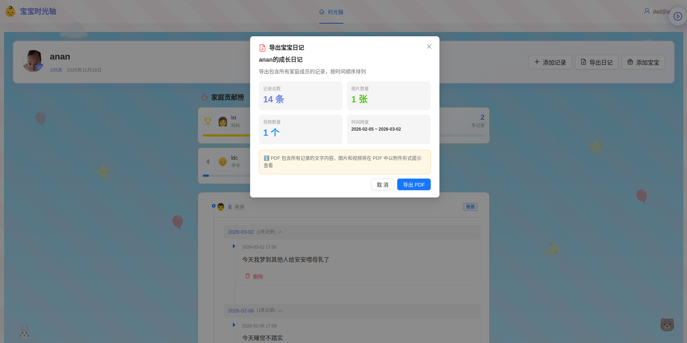
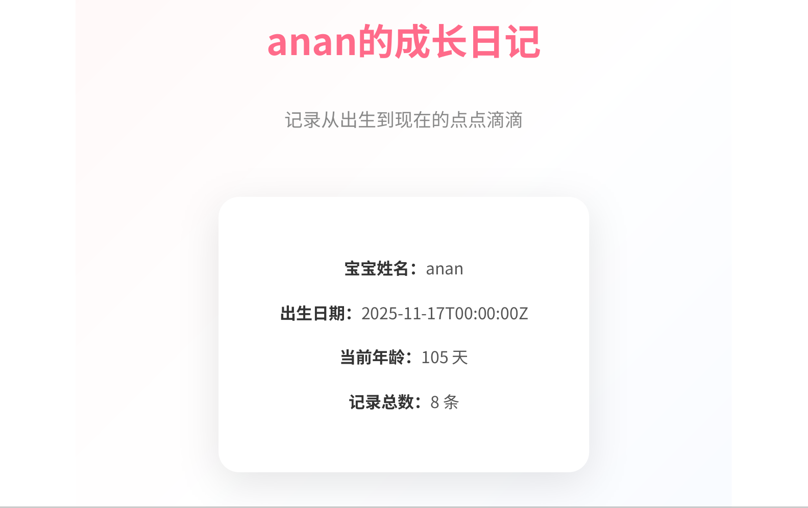

# 宝宝时光轴后端 (Anan Diary Backend)

<div align="center">

[中文](#中文) | [English](#english)

基于 Go + Gin + GORM 的高性能后端服务


</div>

---

## 中文

### 📖 项目简介

宝宝时光轴后端是一个基于 Go 语言开发的高性能 RESTful API 服务，采用 Repository + Handler 架构模式，为前端提供完整的宝宝成长记录管理功能。

### ✨ 核心特性

- 🏗️ **分层架构**: Repository + Handler 模式，职责清晰
- 🔐 **JWT 认证**: 安全的身份验证与授权
- 📊 **GORM ORM**: 类型安全的数据库操作
- 📝 **PDF 导出**: 使用 Chrome Headless 生成精美 PDF
- 🔄 **数据库迁移**: 完善的迁移脚本管理
- 🛡️ **权限控制**: 基于角色的访问控制
- 📈 **统计接口**: 丰富的数据统计 API

### 🛠️ 技术栈

| 组件 | 版本 | 说明 |
|------|------|------|
| Go | 1.23+ | 主要开发语言 |
| Gin | v1.9.1 | Web 框架 |
| GORM | v1.25.5 | ORM 框架 |
| PostgreSQL | 14+ | 关系型数据库 |
| pgx | v5 | PostgreSQL 驱动 |
| JWT | golang-jwt/jwt/v5 | 身份认证 |
| Zap | uber.org/zap | 高性能日志 |

### 📁 项目结构

```
ad-backend/
├── cmd/
│   ├── server/                # 主程序入口
│   │   └── main.go            # 服务器启动、路由配置
│   ├── fontgen/               # 字体生成工具
│   └── test/                  # 测试服务器
├── internal/
│   ├── models/                # 数据模型层
│   │   ├── user.go            # 用户模型
│   │   ├── baby.go            # 宝宝模型
│   │   ├── family_member.go   # 家庭成员模型
│   │   ├── growth_record.go   # 成长记录模型
│   │   ├── milestone.go       # 里程碑模型
│   │   ├── invitation.go      # 邀请码模型
│   │   ├── approval.go        # 审批模型
│   │   ├── permission.go      # 权限模型
│   │   ├── like.go            # 点赞模型
│   │   ├── comment.go         # 评论模型
│   │   ├── stats.go           # 统计模型
│   │   └── subscription.go    # 订阅模型
│   ├── repository/            # 数据访问层 (GORM)
│   │   ├── user_repo.go
│   │   ├── baby_repo.go
│   │   ├── family_member_repo.go
│   │   ├── growth_record_repo.go
│   │   ├── milestone_repo.go
│   │   ├── invitation_repo.go
│   │   ├── approval_repo.go
│   │   ├── permission_repo.go
│   │   ├── like_repo.go
│   │   ├── comment_repo.go
│   │   ├── stats_repo.go
│   │   └── subscription_repo.go
│   └── handlers/              # HTTP 请求处理层
│       ├── auth.go            # 认证处理
│       ├── baby.go            # 宝宝档案处理
│       ├── family_member.go   # 家庭成员处理
│       ├── growth_record.go   # 成长记录处理
│       ├── milestone.go       # 里程碑处理
│       ├── invitation_handler.go    # 邀请码处理
│       ├── approval_handler.go      # 审批处理
│       ├── permission_handler.go    # 权限处理
│       ├── like_handler.go          # 点赞处理
│       ├── comment_handler.go       # 评论处理
│       ├── stats_handler.go         # 统计处理
│       ├── subscription_handler.go  # 订阅处理
│       └── export_handler.go        # PDF 导出处理
├── pkg/
│   ├── database/              # 数据库配置
│   │   └── database.go
│   ├── middleware/            # 中间件
│   │   └── auth.go            # JWT 认证中间件
│   └── response/              # 响应封装
│       └── response.go
├── migrations/                # 数据库迁移脚本
│   ├── init.sql               # 初始化脚本
│   └── 002-013_*.sql          # 增量迁移
├── uploads/                   # 上传文件目录
│   ├── avatars/               # 用户头像
│   └── records/               # 成长记录媒体
│       ├── images/
│       └── videos/
├── fonts/                     # 字体文件 (PDF 生成用)
├── go.mod                     # Go 模块依赖
├── go.sum                     # 依赖校验
└── Makefile                   # 构建脚本
```

### 🚀 快速开始

#### 环境要求

- Go 1.23+
- PostgreSQL 14+
- Chrome/Chromium (用于 PDF 导出)

#### 安装依赖

```bash
cd ad-backend
go mod download
```

#### 配置数据库

编辑 `migrations/init.sql` 或使用环境变量配置数据库连接：

```bash
DB_HOST=localhost
DB_PORT=5432
DB_USER=postgres
DB_PASSWORD=your_password
DB_NAME=anan_diary
```

#### 初始化数据库

```bash
make migrate
# 或手动执行
psql -h localhost -U postgres -f migrations/init.sql
```

#### 启动服务

```bash
# 编译并运行
make run

# 或直接运行
go run cmd/server/main.go
```

服务将在 `http://localhost:8080` 启动。

### 🔧 开发命令

```bash
make build     # 编译项目
make run       # 编译并运行
make test      # 运行测试
make clean     # 清理编译文件
make fmt       # 格式化代码
make deps      # 依赖检查
```

### 📡 API 接口

#### 认证模块
| 方法 | 路径 | 说明 | 认证 |
|------|------|------|------|
| POST | `/api/auth/register` | 用户注册 | ❌ |
| POST | `/api/auth/login` | 用户登录 | ❌ |
| GET | `/api/auth/me` | 获取当前用户 | ✅ |

#### 宝宝档案模块
| 方法 | 路径 | 说明 | 认证 |
|------|------|------|------|
| GET | `/api/baby/current` | 获取当前宝宝 | ✅ |
| GET | `/api/baby` | 获取宝宝列表 | ✅ |
| POST | `/api/baby` | 创建宝宝档案 | ✅ |
| GET | `/api/baby/:id` | 获取宝宝详情 | ✅ |
| DELETE | `/api/baby/:id` | 删除宝宝档案 | ✅ |
| POST | `/api/baby/:id/avatar` | 上传头像 | ✅ |

#### 成长记录模块
| 方法 | 路径 | 说明 | 认证 |
|------|------|------|------|
| GET | `/api/growth-record/timeline` | 获取时光轴 | ✅ |
| POST | `/api/growth-record` | 创建成长记录 | ✅ |
| DELETE | `/api/growth-record/:id` | 删除记录 | ✅ |
| POST | `/api/growth-record/media` | 上传媒体 | ✅ |
| GET | `/api/growth-record/:id/media` | 获取媒体 | ✅ |

#### 家庭成员模块
| 方法 | 路径 | 说明 | 认证 |
|------|------|------|------|
| GET | `/api/family-member/:baby_id` | 获取成员列表 | ✅ |
| POST | `/api/family-member` | 添加成员 | ✅ |

#### 邀请码模块
| 方法 | 路径 | 说明 | 认证 |
|------|------|------|------|
| POST | `/api/invitation/generate` | 生成邀请码 | ✅ |
| GET | `/api/invitation/:baby_id/codes` | 获取邀请码 | ✅ |
| POST | `/api/invitation/join` | 使用邀请码 | ✅ |
| POST | `/api/invitation/revoke/:baby_id` | 撤销邀请码 | ✅ |

#### 审批模块
| 方法 | 路径 | 说明 | 认证 |
|------|------|------|------|
| GET | `/api/approval/:baby_id` | 获取审批列表 | ✅ |
| GET | `/api/approval/my` | 获取我的审批 | ✅ |
| POST | `/api/approval/detail/:id/approve` | 批准 | ✅ |
| POST | `/api/approval/detail/:id/reject` | 拒绝 | ✅ |

#### 权限模块
| 方法 | 路径 | 说明 | 认证 |
|------|------|------|------|
| GET | `/api/permission/:baby_id/members` | 获取成员 | ✅ |
| PUT | `/api/permission/:baby_id` | 更新权限 | ✅ |
| DELETE | `/api/permission/member/:user_id` | 移除成员 | ✅ |

#### 社交互动模块
| 方法 | 路径 | 说明 | 认证 |
|------|------|------|------|
| POST | `/api/like/record/:id` | 点赞 | ✅ |
| DELETE | `/api/like/record/:id` | 取消点赞 | ✅ |
| POST | `/api/comment/record/:id` | 添加评论 | ✅ |
| GET | `/api/comment/record/:id` | 获取评论 | ✅ |

#### 统计模块
| 方法 | 路径 | 说明 | 认证 |
|------|------|------|------|
| GET | `/api/stats/user` | 用户统计 | ✅ |
| GET | `/api/stats/baby/:baby_id/members` | 成员统计 | ✅ |
| GET | `/api/stats/baby/:baby_id/ranking` | 排行榜 | ✅ |
| GET | `/api/stats/daily` | 今日统计 | ✅ |
| GET | `/api/stats/weekly` | 本周统计 | ✅ |
| GET | `/api/stats/monthly` | 本月统计 | ✅ |

#### 订阅模块
| 方法 | 路径 | 说明 | 认证 |
|------|------|------|------|
| GET | `/api/subscription/detail` | 订阅详情 | ✅ |
| GET | `/api/subscription/plans` | 订阅计划 | ✅ |
| POST | `/api/subscription/payment` | 记录支付 | ✅ |
| POST | `/api/subscription/renew` | 续期 | ✅ |
| POST | `/api/subscription/cancel` | 取消订阅 | ✅ |

#### PDF 导出模块
| 方法 | 路径 | 说明 | 认证 |
|------|------|------|------|
| GET | `/api/export/pdf` | 导出 PDF | ✅ |
| GET | `/api/export/preview` | 导出预览 | ✅ |

### 🗄️ 数据模型

#### User (用户)
```go
type User struct {
    ID           uint      `gorm:"primaryKey"`
    Email        string    `gorm:"uniqueIndex;not null"`
    PasswordHash string    `gorm:"not null"`
    Role         string    `gorm:"size:20"`  // 爸爸/妈妈/爷爷/奶奶/姥姥/姥爷/哥哥/姐姐
    Name         string    `gorm:"size:50"`
    CreatedAt    time.Time
    UpdatedAt    time.Time
}
```

#### Baby (宝宝)
```go
type Baby struct {
    ID        uint      `gorm:"primaryKey"`
    UserID    uint      `gorm:"not null;index"`  // 创建者
    Name      string    `gorm:"size:100;not null"`
    BirthDate string    `gorm:"type:timestamp;not null"`  // 出生日期
    BabyID    string    `gorm:"uniqueIndex;size:50;not null"`  // 出生证编号
    Avatar    string    `gorm:"size:255"`  // 头像 URL
    CreatedAt time.Time
    UpdatedAt time.Time
}
```

#### FamilyMember (家庭成员)
```go
type FamilyMember struct {
    ID        uint      `gorm:"primaryKey"`
    BabyID    uint      `gorm:"not null;index"`
    UserID    uint      `gorm:"not null;index"`
    Role      string    `gorm:"size:20;not null"`  // 家庭角色
    Name      string    `gorm:"size:50"`
    IsPremium bool      `gorm:"default:false"`
    CreatedAt time.Time
    UpdatedAt time.Time
}
// UNIQUE(baby_id, role) - 确保每种角色唯一
```

#### GrowthRecord (成长记录)
```go
type GrowthRecord struct {
    ID        uint      `gorm:"primaryKey"`
    BabyID    uint      `gorm:"not null;index"`
    UserID    uint      `gorm:"not null;index"`  // 创建者
    Content   string    `gorm:"type:text;not null"`
    Tags      string    `gorm:"type:text"`  // JSON 数组
    Media     string    `gorm:"type:text"`  // JSON 数组
    CreatedAt time.Time
}
// UNIQUE(baby_id, created_at, content) - 防止重复
```

### 🔒 安全特性

- **JWT Token 认证**: 所有受保护接口需要有效 Token
- **密码加密**: 使用 bcrypt 加密存储密码
- **角色权限**: 基于角色的访问控制
- **数据隔离**: 用户只能访问自己家庭的数据
- **防篡改**: 成长记录创建后不可修改

### 📄 PDF 导出功能

PDF 导出功能使用 Chrome Headless 生成，包含：
- 精美封面页
- 记录列表页（每页 5 条）
- 温馨封底页

#### PDF 导出效果展示

<div align="center">
  
  <p><em>PDF 导出功能入口</em></p>
</div>

<div align="center">
  
  <p><em>精美的 PDF 封面页</em></p>
</div>

<div align="center">
  
  <p><em>成长记录文字列表页</em></p>
</div>

<div align="center">
  
  <p><em>带图片的成长记录页</em></p>
</div>

需要服务器安装 Chrome/Chromium：
```bash
# Ubuntu/Debian
sudo apt-get install chromium-browser

# CentOS/RHEL
sudo yum install chromium
```

### 🔧 环境变量

| 变量名 | 说明 | 默认值 |
|--------|------|--------|
| `DB_HOST` | 数据库主机 | localhost |
| `DB_PORT` | 数据库端口 | 5432 |
| `DB_USER` | 数据库用户 | postgres |
| `DB_PASSWORD` | 数据库密码 | - |
| `DB_NAME` | 数据库名称 | anan_diary |
| `JWT_SECRET` | JWT 密钥 | - |
| `SERVER_PORT` | 服务器端口 | 8080 |

### 📋 开发计划

- [ ] AI 成长小结生成
- [ ] 数据导出增强（Excel、Word）
- [ ] 消息通知系统
- [ ] 定时任务支持
- [ ] API 限流
- [ ] 数据备份

### 📄 许可证

MIT License

---

## English

### 📖 Introduction

Anan Diary Backend is a high-performance RESTful API service developed in Go, using Repository + Handler architecture pattern, providing complete baby growth record management functionality for the frontend.

### ✨ Key Features

- 🏗️ **Layered Architecture**: Repository + Handler pattern with clear responsibilities
- 🔐 **JWT Authentication**: Secure identity verification and authorization
- 📊 **GORM ORM**: Type-safe database operations
- 📝 **PDF Export**: Generate beautiful PDFs using Chrome Headless
- 🔄 **Database Migration**: Complete migration script management
- 🛡️ **Access Control**: Role-based access control
- 📈 **Statistics API**: Rich data statistics endpoints

### 🛠️ Technology Stack

| Component | Version | Description |
|------|------|------|
| Go | 1.23+ | Main programming language |
| Gin | v1.9.1 | Web framework |
| GORM | v1.25.5 | ORM framework |
| PostgreSQL | 14+ | Relational database |
| pgx | v5 | PostgreSQL driver |
| JWT | golang-jwt/jwt/v5 | Authentication |
| Zap | uber.org/zap | High-performance logging |

### 📁 Project Structure

```
ad-backend/
├── cmd/
│   ├── server/                # Main program entry
│   │   └── main.go            # Server startup, routing configuration
│   ├── fontgen/               # Font generation tool
│   └── test/                  # Test server
├── internal/
│   ├── models/                # Data models layer
│   ├── repository/            # Data access layer (GORM)
│   └── handlers/              # HTTP request handlers
├── pkg/
│   ├── database/              # Database configuration
│   ├── middleware/            # Middleware (JWT, etc.)
│   └── response/              # Response wrapper
├── migrations/                # Database migration scripts
├── uploads/                   # Uploaded files storage
├── fonts/                     # Font files (for PDF generation)
├── go.mod                     # Go module dependencies
├── go.sum                     # Dependencies checksum
└── Makefile                   # Build scripts
```

### 🚀 Quick Start

#### Prerequisites

- Go 1.23+
- PostgreSQL 14+
- Chrome/Chromium (for PDF export)

#### Install Dependencies

```bash
cd ad-backend
go mod download
```

#### Configure Database

Edit `migrations/init.sql` or use environment variables:

```bash
DB_HOST=localhost
DB_PORT=5432
DB_USER=postgres
DB_PASSWORD=your_password
DB_NAME=anan_diary
```

#### Initialize Database

```bash
make migrate
# Or manually
psql -h localhost -U postgres -f migrations/init.sql
```

#### Start Server

```bash
# Build and run
make run

# Or run directly
go run cmd/server/main.go
```

Server will start at `http://localhost:8080`.

### 🔧 Make Commands

```bash
make build     # Build project
make run       # Build and run
make test      # Run tests
make clean     # Clean build files
make fmt       # Format code
make deps      # Check dependencies
```

### 📡 API Endpoints

See the Chinese section above for complete API documentation.

### 🗄️ Data Models

See the Chinese section above for complete data model definitions.

### 🔒 Security Features

- **JWT Token Authentication**: Valid token required for protected endpoints
- **Password Encryption**: Passwords encrypted with bcrypt
- **Role-Based Access**: Role-based access control
- **Data Isolation**: Users can only access their family data
- **Tamper-Proof**: Growth records cannot be modified after creation

### 📄 PDF Export

PDF export uses Chrome Headless, including:
- Beautiful cover page
- Record list pages (5 records per page)
- Warm back cover page

#### PDF Export Screenshots

<div align="center">
  
  <p><em>PDF Export Feature</em></p>
</div>

<div align="center">
  
  <p><em>Beautiful Cover Page</em></p>
</div>

<div align="center">
  
  <p><em>Record List Page</em></p>
</div>

<div align="center">
  
  <p><em>Page with Images</em></p>
</div>

Server needs Chrome/Chromium installed.

### 🔧 Environment Variables

| Variable | Description | Default |
|------|------|------|
| `DB_HOST` | Database host | localhost |
| `DB_PORT` | Database port | 5432 |
| `DB_USER` | Database user | postgres |
| `DB_PASSWORD` | Database password | - |
| `DB_NAME` | Database name | anan_diary |
| `JWT_SECRET` | JWT secret key | - |
| `SERVER_PORT` | Server port | 8080 |

### 📋 Roadmap

- [ ] AI-powered growth summary generation
- [ ] Enhanced data export (Excel, Word)
- [ ] Notification system
- [ ] Scheduled tasks support
- [ ] API rate limiting
- [ ] Data backup

---

## 🚀 部署指南

### 生产环境部署

#### 1. 使用 systemd 部署

```bash
# 编译
cd /path/to/ad-backend
go build -o bin/server cmd/server/main.go

# 创建服务文件
sudo tee /etc/systemd/system/anan-backend.service > /dev/null <<EOF
[Unit]
Description=Anan Diary Backend Service
After=network.target postgresql.service

[Service]
Type=simple
User=www-data
WorkingDirectory=/path/to/ad-backend
ExecStart=/path/to/ad-backend/bin/server
Restart=on-failure
RestartSec=5
Environment="DB_HOST=localhost"
Environment="DB_PORT=5432"
Environment="DB_USER=anan_user"
Environment="DB_PASSWORD=your_password"
Environment="DB_NAME=anan_diary"
Environment="JWT_SECRET=your-jwt-secret"
Environment="SERVER_PORT=8080"

[Install]
WantedBy=multi-user.target
EOF

# 启动服务
sudo systemctl daemon-reload
sudo systemctl enable anan-backend
sudo systemctl start anan-backend
sudo systemctl status anan-backend
```

#### 2. 使用 Docker 部署

```dockerfile
# Dockerfile
FROM golang:1.23-alpine AS builder
WORKDIR /app
COPY go.mod go.sum ./
RUN go mod download
COPY . .
RUN CGO_ENABLED=0 GOOS=linux go build -o server cmd/server/main.go

FROM alpine:latest
RUN apk --no-cache add ca-certificates chromium
WORKDIR /root/
COPY --from=builder /app/server .
COPY --from=builder /app/uploads ./uploads
EXPOSE 8080
CMD ["./server"]
```

```bash
# 构建镜像
docker build -t anan-diary-backend .

# 运行容器
docker run -d \
  -p 8080:8080 \
  -e DB_HOST=postgres \
  -e DB_USER=anan_user \
  -e DB_PASSWORD=your_password \
  -e DB_NAME=anan_diary \
  -e JWT_SECRET=your-jwt-secret \
  -v ./uploads:/root/uploads \
  anan-diary-backend
```

### 性能优化

- 使用连接池
- 启用 Gzip 压缩
- 配置静态文件缓存
- 使用 Redis 缓存（可选）

---

## English

### 🚀 Deployment Guide

See the Chinese section above for detailed deployment instructions.

### 📄 License

MIT License
